

  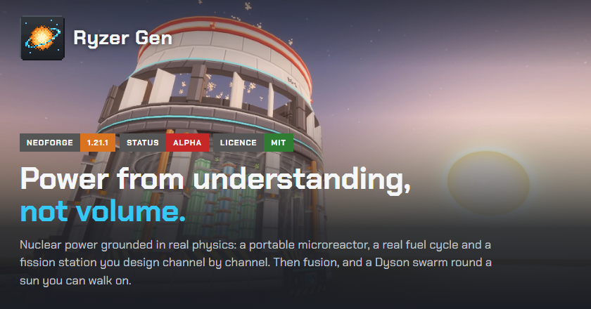

  <a href="https://www.curseforge.com/minecraft/mc-mods/ryzer-gen"><b>Download on CurseForge</b></a> ·
  <a href="https://github.com/MultiRyzer/ryzer-gen/releases">Releases</a> ·
  <a href="https://discord.gg/cmUZcRtqfg">Discord</a> ·
  <a href="https://github.com/MultiRyzer/ryzer-gen/issues">Report a bug</a>

# Ryzer Gen

A NeoForge mod for Minecraft 1.21.1 (the version ATM10 runs on) about power progression through physics. Start with a portable microreactor, recycle its spent fuel into MOX, design a fission station channel by channel and breed new fuel in a fast reactor, on the way to fusion and a Dyson swarm round a sun you can walk on.

Most reactor mods answer "how do I get more power?" with "build it bigger". Here a small, well-designed machine beats a big sloppy one: progress comes from understanding, not volume.

**Public alpha.** Tiers 1 to 4 are playable. Balance is a first pass and may change between versions, so back up your world before updating. The latest build is on the [Releases](https://github.com/MultiRyzer/ryzer-gen/releases) page and [CurseForge](https://www.curseforge.com/minecraft/mc-mods/ryzer-gen).

  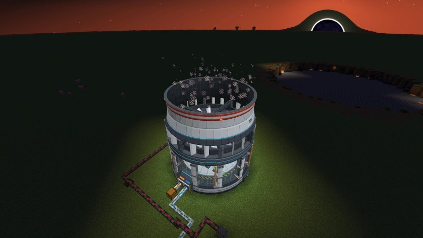

## What's in it

**Tier 1: the microreactor.** A four-block portable reactor based on real transportable "nuclear battery" designs and TRISO fuel. Heat, fuel life and coolant: water makes it run better and turns into steam. Take the safeties off for more power, and lose your coolant at your peril. Batteries, cables, item, fluid and gas pipes, an intake pump and tanks come with it.

**Tier 2: the fuel cycle.** Spent fuel is the next fuel. Crack depleted cores, reprocess them into uranium and plutonium, and fabricate uranium and MOX rods, much as France recycles its fuel. Hot spent fuel cools in the Spent Fuel Pool, a multiblock with a crane that lifts the rods out when they are done. Store power in the Container Battery, and dig with the Mega Drill, a quarry tower that bores a shaft to the bottom of the world.

**Tier 3: the fission station.** A round station with a glass chamber and a giant roof turbine, which builds itself from its parts. You plan its 5 x 5 core channel by channel (fuel, moderator, control rod, coolant), and a planner rates your layout against the best ones found. Watch the core through the glass: fuel glowing green, coolant Cherenkov blue. SCRAM at 900°C, or take the safeties off and risk a flux tilt and a meltdown that leaves a crater.

**Tier 4: the breeder and thorium.** A sodium-cooled fast reactor in a steel sphere that burns what the station cannot, and makes more fuel than it uses. Blankets round its core breed plutonium for MOX, or U-233 from thorium. Keep its pumps running: a hot core with no flow boils its sodium into a fire.

**Across the mod**
- **The progression map.** Press Y for the whole production line, from ore in the ground to the sun. The steps you have reached light up and the next ones pulse.
- **Steady state.** A reactor that keeps running builds a streak that raises its output.
- **Radiation, done fairly.** It comes only from running reactors and meltdown sites; ores, fuel and waste are safe to carry. It falls off with distance and shielding, and a Geiger counter and a dosimeter ring help you live with it. It can be turned off.
- **The reactors talk.** An announcer calls out safeties, SCRAMs, coolant loss and meltdowns as they happen.

**The endgame (preview).** A swarm of solar panels launches round the sun, closes into a shell that shuts out the daylight, then collapses the sun into a wormhole that bends the sky. For now it is a creative-only preview; the tiers that build it in survival come later. Fusion comes first: see the [roadmap](docs/ROADMAP.md).

<table>
  <tr>
    <td>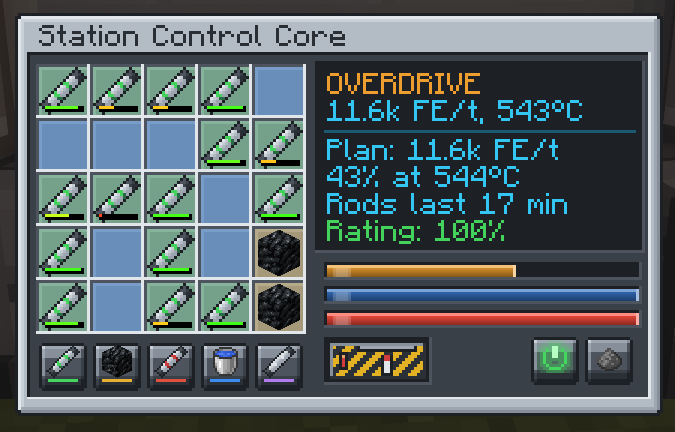</td>
    <td>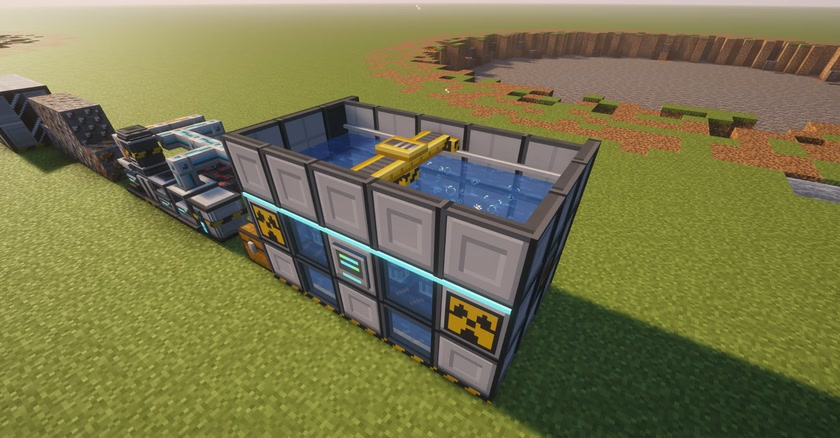</td>
  </tr>
  <tr>
    <td>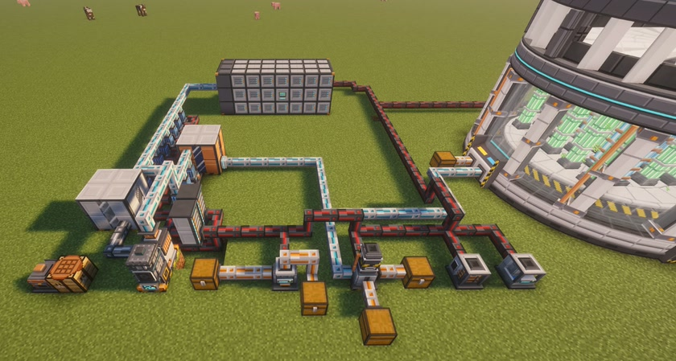</td>
    <td>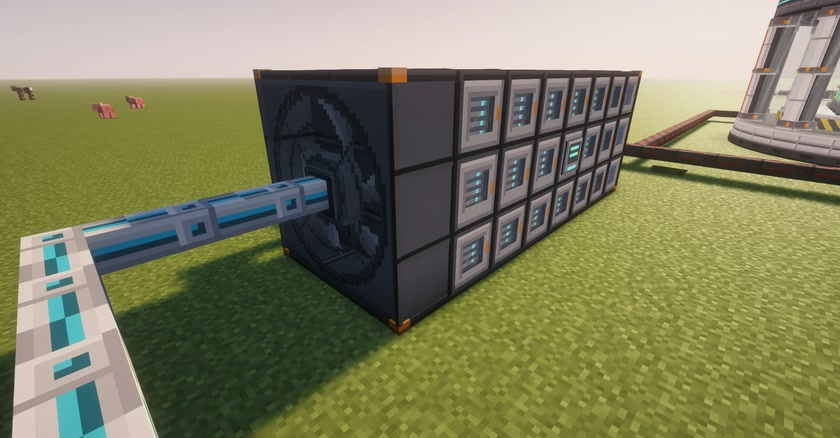</td>
  </tr>
  <tr>
    <td colspan="2">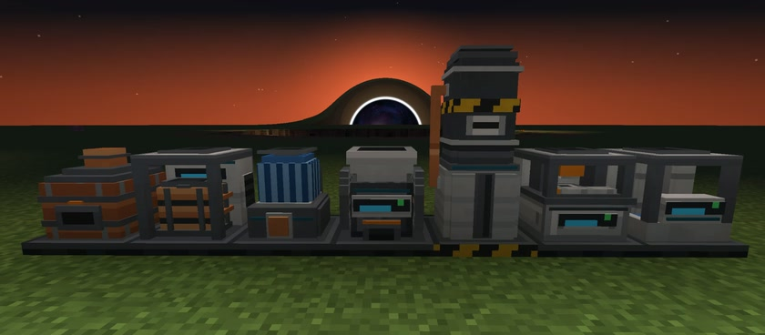</td>
  </tr>
  <tr>
    <td>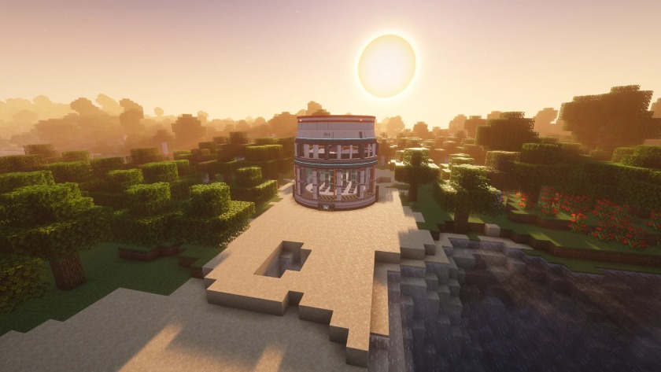</td>
    <td>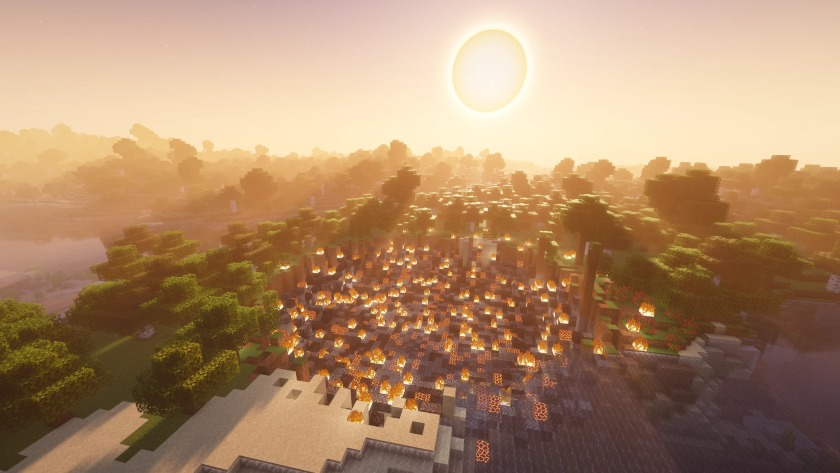</td>
  </tr>
  <tr>
    <td>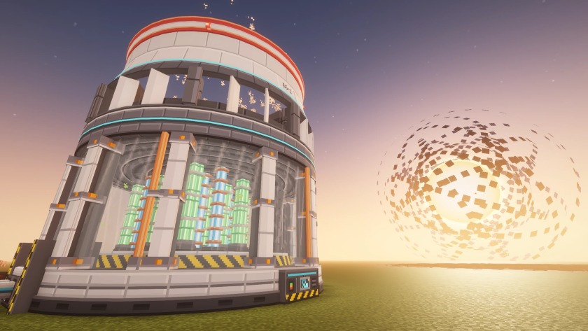</td>
    <td>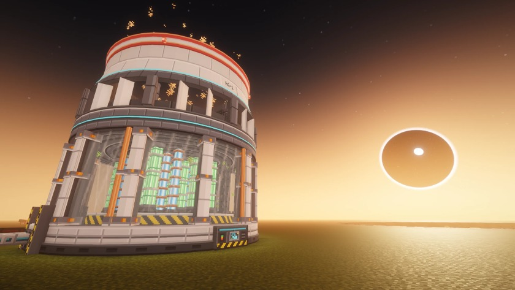</td>
  </tr>
</table>

## Installing

- NeoForge for Minecraft 1.21.1, version 21.1.249 or newer. Drop the jar into your `mods` folder.
- Standalone: it ships every ore it uses. Optional support for JEI, EMI and Accessories (the dosimeter ring's slot).
- Settings live in `config/ryzergen-common.toml`: radiation, meltdowns, ore generation, fuel cooling, output and more.

**For pack makers.** FE energy throughout, data-driven recipes and worldgen, and every recipe asks for common tags (`c:ingots/uranium`, `c:dusts/lead`, ...), so other mods' materials just work. Every ore has its own worldgen switch, and one switch turns them all off. Pipes and cables share one network per group and only tick where they pull from something, so big bases stay light. MIT licensed: put it in any pack.

## Help and bugs

- Questions, core designs and work in progress: the [Discord](https://discord.gg/cmUZcRtqfg) (`#help`).
- Bugs: [open an issue](https://github.com/MultiRyzer/ryzer-gen/issues) with your log, your Minecraft, NeoForge and Ryzer Gen versions, your modpack if you use one, and the steps to make it happen.

## Building from source

Java 21. From `mod/`:

| Command | What it does |
|---|---|
| `./gradlew build` | Compiles and packages the jar into `mod/build/libs/` |
| `./gradlew runClient` | Launches a test client with the mod loaded |
| `./gradlew runData` | Regenerates models, loot, tags and recipes into `src/generated/` |
| `./gradlew runGameTestServer` | Runs the game tests on a headless server |

Every texture, model and big machine design is drawn by Python scripts in `art/tools/`, with no image editor and no PIL. A machine's `<name>_textures.py` publishes its textures; the big machines' `<name>_concept.py` scripts export their designs too (run `runData` after changing one).

## What's where

| Folder | What goes in it |
|---|---|
| `docs/` | The design (`DESIGN.md`, the source of truth), the roadmap, open questions, the changelog and the mod page text |
| `mod/` | The NeoForge Gradle project |
| `art/tools/` | The Python scripts that draw the textures, GUIs, sounds and machine designs |
| `art/textures/` | The finished textures the scripts publish (also copied into the mod) |
| `art/designs/` | Multiblock designs the scripts export, cut into block models by `runData` |
| `art/concepts/` | Concept renders of machines before and after they reach the game |
| `art/gallery/` | Screenshots and the mod page's banners |
| `art/sounds/` | Sound credits (`CREDITS.md`) |

New here? Read `docs/DESIGN.md` for the full vision and `docs/ROADMAP.md` for what comes next.

## Licence

MIT licensed (see `LICENSE`). Sounds keep their own licences; see `art/sounds/CREDITS.md`.

Opus 5.5 assisted.
