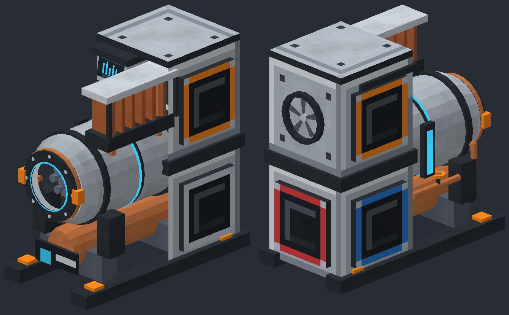

# Capsule: horizontal microreactor concept



A fresh design built from its own geometry and textures. The horizontal reactor drum sits on two
thick saddles and graphite skids. A bolted inspection hatch, orange latch dogs and copper rim give
the front its identity. The sealed core can be seen through a small window. It is not a glass tank.

A low copper secondary heat exchanger runs beneath the pressure body. An asymmetric copper-fin
radiator rises over one shoulder, with an angled instrument console on the other. The rear service
spine houses the generator and the existing five automation connections. An external valve and
guarded coolant sight tube make its operation visible without opening up the entire reactor.

## Mechanical intent

The enclosed horizontal vessel contains the sealed fuel core and primary coolant. The lower
exchanger transfers heat into a secondary circuit connected to the rear generator. The raised fins
suggest residual cooling and auxiliary heat rejection. They are not intended to imply that this
small radiator alone carries all reactor heat. The cyan window ring is a status light, not plasma.

The existing coolant, heat, fuel-life and safety mechanics can support this appearance. There are
no proposed new recipes or balance changes. This is a visual concept, not an engineering design
for a real reactor.

## Model and previews

- `front_and_back.png`: two views of the running machine.
- `front.png`: closer view of the front hatch and instruments.
- `side.png`: the horizontal vessel silhouette.
- `states.png`: idle, running, overdrive and coolant loss, left to right.
- `capsule.json`: 1,886 generated quads in the shared design format.
- `textures/`: original procedural texture assets, using the mod's palette.
- `animation_layout.json`: proposed moving-part axes and state feedback.

Generate again from the repo root:

```text
python art/tools/microreactor_capsule_concept.py
```

The concept preserves the one-wide, two-deep, two-high footprint. Coolant enters the lower rear
block's east face, steam leaves west, power leaves south. Fuel enters the upper rear block east
and spent fuel leaves west. Every flange is centred on its block face, with a ten-pixel flange
around an eight-pixel socket.

The generator verifies finite geometry, texture references, unit normals and footprint bounds.
The previews have been visually inspected. Nothing has been installed or changed in the existing
mod. Unlike the previous alternative, this model needs new renderer transforms for its horizontal
core and coolant gauge. The model format is already supported, but animation integration and
in-game transparency, facing and shader checks remain future work.
