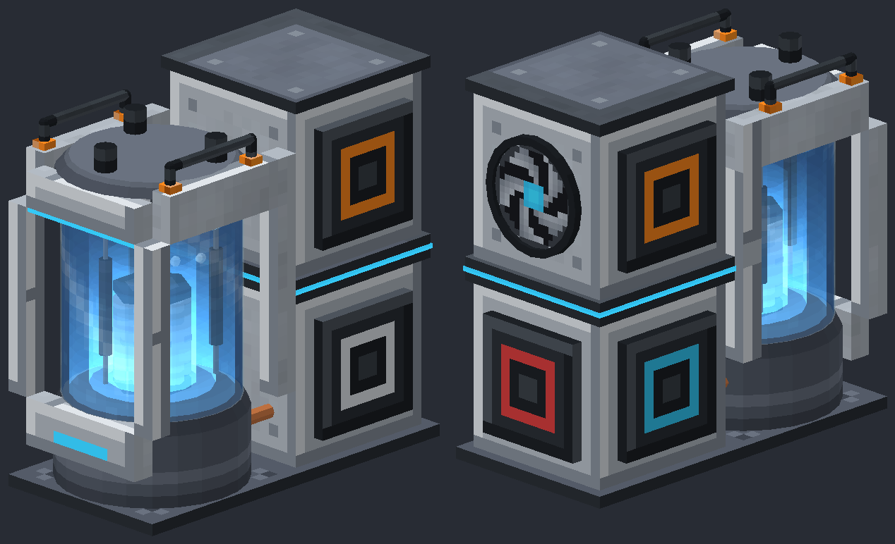

# Shieldcell microreactor concept

A preview alternative to the Lantern. No game resources or existing art generators were changed.



The reactor has a pale structural shield frame, a recessed vessel head, graphite lifting handles,
orange fixing lugs and thin cyan status strips. The front viewing chamber shows the core, water
and control rods. Copper pipes join it to the rear heat exchanger and generator cabinet.
The glass chamber is a gameplay cutaway, rather than a claim that this small water volume gives
real reactor shielding. This follows the readable teaching model described in DESIGN.md.

## Preview files

- `front_and_back.png`: both sides while running.
- `states.png`: idle, running, overdrive and coolant loss, left to right.
- `idle.png`, `running.png`, `overdrive.png`, `loss.png`: individual states.
- `shieldcell.json`: generated quad geometry in the existing renderer's format.
- `textures/`: procedural texture assets used by the concept.

Regenerate from the repository root:

```text
python art/tools/microreactor_shieldcell_concept.py
```

## Compatibility

The footprint is one block wide, two deep and two high. The front lower block is the origin.
The core, water, absorber travel and rear fan retain the Lantern renderer's coordinates.
All eleven required geometry groups are present. The water and glow remain live renderer effects.
The state pictures use the existing software preview renderer and are not game screenshots.

Facing north, the rear connections remain:

| Connection | Block | Face | Flange centre in design pixels |
|---|---|---|---|
| Coolant input | Lower rear | East | 16, 8, 24 |
| Steam output | Lower rear | West | 0, 8, 24 |
| Energy output | Lower rear | South | 8, 8, 32 |
| Fresh fuel input | Upper rear | East | 16, 24, 24 |
| Spent fuel output | Upper rear | West | 0, 24, 24 |

The export contains 1,780 quads, with 960 in the static body. The generator checks required groups,
texture references, finite coordinates, unit normals and footprint bounds. A 0.01-pixel offset
on the status display prevents coplanar flicker.

For a later installation, copy the generated textures to the matching
`assets/ryzergen/textures/block/microreactor_shieldcell/` folder and the geometry to
`assets/ryzergen/microreactor/shieldcell.json`, then point MicroreactorRenderer's DATA constant at it.
The existing live water and glow textures stay available. An in-game check is still needed for
transparency, resource reloads, facing and shader-pack rendering. This preview does not establish
those checks have passed.
